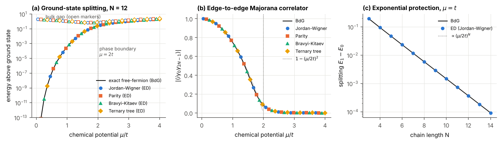
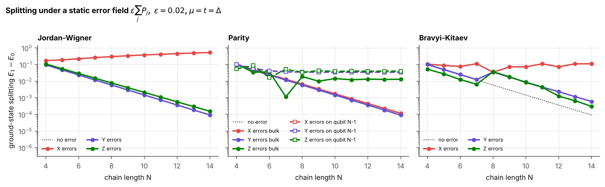
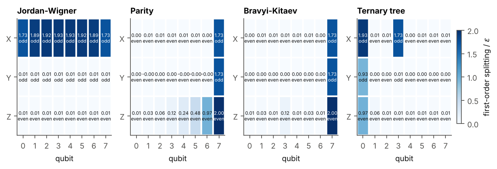
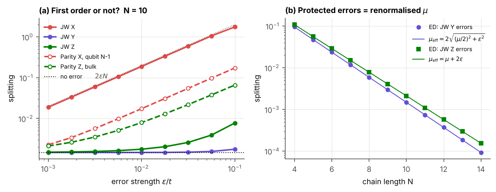
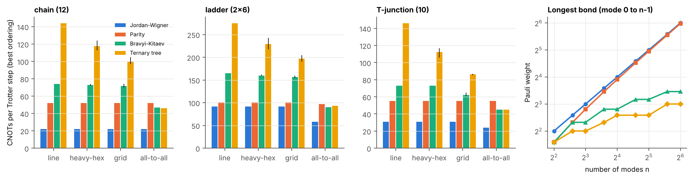
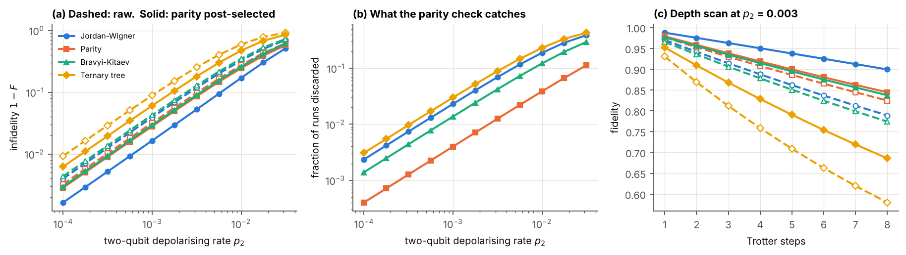

# Results

All numbers below are in `results/*.json` and are regenerated by `python scripts/run_experiments.py`. Energies are in units of the hopping t.

## E1. Validation: the encodings preserve the physics

* N = 12 chain, Delta = t, 40 values of mu in [0.05, 4]. For Jordan-Wigner, parity, Bravyi-Kitaev and ternary tree, the ground energy, the splitting E1 - E0, the bulk gap and the edge correlator |<i g_0 g_{2N-1}>| all agree with the exact free-fermion (BdG) solution to **3.4 x 10^-13**.
* Full spectra (all 2^N levels) of the four encodings agree to **6 x 10^-14** on a chain (8), a ladder (2x4) and a T-junction (7) with Delta = 0.6 t, and match the spectrum rebuilt from the free-fermion levels.
* The splitting falls as (mu/2t)^N inside the topological phase (panel c: 9.2 x 10^-5 at N = 14, mu = t) and the edge correlator follows 1 - (mu/2t)^2, vanishing at the transition mu = 2t.
* Independent check: PennyLane's own transforms give the same spectra (`tests/test_pennylane_crosscheck.py`).

Interpretation: all irreducible representations of the 2N Majorana operators are unitarily equivalent, so the spectrum cannot depend on the encoding. The experiment confirms the code respects that theorem, which is what lets E2-E4 attribute every difference to the *errors* and the *circuits*, not to the model.

## E2. The error dictionary

Setup: H + eps * sum_j P_j with eps = 0.02, mu = t = Delta; splitting E1 - E0 from exact diagonalisation, N = 4..14.

| Encoding | Error | Fermionic meaning (decoded automatically) | Prediction | Measured at N = 14 | Verdict |
|---|---|---|---|---|---|
| none | none | | e^{-N/xi} | 9.16e-5 | baseline |
| JW | Z_j | -i g_{2j} g_{2j+1}: local, parity-even | protected | 1.54e-4, equals BdG at mu + 2 eps to 3 digits | confirmed |
| JW | X_j | odd, string of 2j+1 Majoranas | first order, grows with N | 0.530, linear in N (slope 0.038 = 2 eps x 0.96) | confirmed |
| JW | Y_j | odd, string of 2j+1 Majoranas | harmless at first order | 9.25e-5: **exactly** a renormalised mu | stronger than predicted |
| Parity | X_j, j < N-1 | -i g_{2j+1} g_{2j+2}: the Kitaev bond | protected | 1.17e-4 | confirmed |
| Parity | Y_j, j < N-1 | even, non-local | not predicted | 9.13e-5 | protected |
| Parity | X or Y on qubit N-1 | odd; Y_{N-1} is the bare edge Majorana | first order | 0.0346 = 2 eps sqrt(1 - (mu/2t)^2), independent of N | confirmed |
| Parity | Z on qubit N-1 | total fermion parity | first order | 0.0399 = 2 eps | confirmed |
| Parity | Z_j, j < N-1 | parity of sites 0..j: even but non-local | not predicted | 0.0130 = 2 eps / 3, independent of N | **new: unprotected** |
| BK | X_j | mixed | | 0.07-0.11, does not decay | unprotected |
| BK | Y_j, Z_j | mixed | | 6.0e-4, 3.1e-4 | decays, slower than baseline |

What we learned beyond the original predictions:

1. **Parity-odd does not mean unprotected.** At Delta = t the Jordan-Wigner Hamiltonian is -t sum XX + (mu/2) sum Z. A Y field can be removed by rotating each qubit about its X axis, which leaves XX untouched and turns (mu/2) Z + eps Y into sqrt((mu/2)^2 + eps^2) Z. So a Y error is *exactly* a slightly larger chemical potential. Exact diagonalisation matches this prediction to all printed digits (fig. 2b). At Delta = 0.6 t the rotation is no longer exact, yet the splitting stays exponentially small (8.7e-5 vs 6.7e-5 baseline at N = 14), as the class-BDI argument predicts.
2. **Parity-even does not mean protected.** In the parity encoding Z_j is fermion-parity-even but non-local: it equals (total parity) x (parity of the sites to the right of j). Its first-order effect is 2 eps (-mu/2t)^(N-1-j), so the logical bit leaks a correlation length into the register. Summing the geometric series gives 2 eps x (-1/3) at mu = t: exactly the measured 0.0130.
3. **The encoding moves the weak spot.** The first-order map (fig. 3) shows it: every qubit (X) under Jordan-Wigner; only the last qubit under parity and Bravyi-Kitaev; the root qubit and one child under the ternary tree.
4. Random-sign disorder (12 seeds) gives the same classification; the Jordan-Wigner X splitting then grows like a random walk instead of linearly.

## E3. Cost of one Trotter step

CNOT count after routing (Qiskit, optimisation level 2, mean of 5 seeds; Delta = 0.6 t so both XX and YY terms are present). Best ordering per encoding.

| Geometry | Connectivity | JW | Parity | BK | Ternary tree |
|---|---|---|---|---|---|
| chain (12) | line | **22** | 52 | 74 | 144 |
| chain (12) | all-to-all | **22** | 52 | 47 | 46 |
| ladder (2x6) | line | **92** | 101 | 165 | 275 |
| ladder (2x6) | all-to-all | **58** | 97 | 90 | 93 |
| T-junction (10) | line | **31** | 55 | 73 | 146 |
| T-junction (10) | all-to-all | **24** | 55 | 45 | 45 |

* In 1D Jordan-Wigner beats Bravyi-Kitaev by 3.4x: nearest-neighbour bonds have weight 2 and the strings cancel.
* Ordering matters as much as the encoding: the ladder numbered leg by leg costs 168 CNOTs under Jordan-Wigner, against 92 rung by rung.
* Heavy-hex and grid give the same cost as a line for Jordan-Wigner and parity because a line embeds in both; the tree encodings need SWAPs and get cheaper as connectivity improves.
* The logarithmic encodings win only for long-range bonds: the weight of a bond between mode 0 and mode n-1 is n (JW), n-1 (parity), ~log2 n (BK: 11 at n = 64) and ~log3 n (ternary tree: 8 at n = 64).

## E4. Noise and parity post-selection

N = 6, mu = t = Delta, 4 Trotter steps of dt = 0.2 on a line; depolarising noise p2 on CNOT and p2/10 on single-qubit gates. Fidelity is measured against the noiseless circuit output. At p2 = 10^-3:

| Encoding | CNOT | 1q gates | Parity-check weight | Raw fidelity | Post-selected | Runs kept | Damage removed |
|---|---|---|---|---|---|---|---|
| JW | 40 | 71 | 6 | 0.9609 | **0.9836** | 97.7% | 58% |
| Parity | 40 | 40 | 1 | **0.9681** | 0.9720 | 99.6% | 12% |
| BK | 49 | 60 | 2 | 0.9574 | 0.9707 | 98.6% | 31% |
| Ternary tree | 106 | 97 | 2 | 0.9114 | 0.9395 | 97.0% | 32% |

* Raw ranking: parity > JW > BK > ternary tree (fewest gates wins).
* Post-selected ranking: JW > parity ~ BK > ternary tree. The fermion-parity operator is Z on all N qubits under Jordan-Wigner, so any X or Y error flips it; under the parity encoding it is Z on one qubit and misses almost everything.
* We looked for a noise rate at which the ranking flips and **did not find one** between p2 = 10^-4 and 3 x 10^-2: the ordering is set by whether post-selection is used, not by the noise strength. The gap widens with depth (panel c).
* This is the same trade-off as E2 seen from the other side: Jordan-Wigner exposes every qubit to symmetry-breaking errors, and for exactly that reason it can detect them.

## Limitations

See the README. The most important ones for interpreting the numbers: E2 uses static fields (coherent errors), E4 uses gate depolarising noise without idle or readout errors, and E3 depends on the synthesis method.
